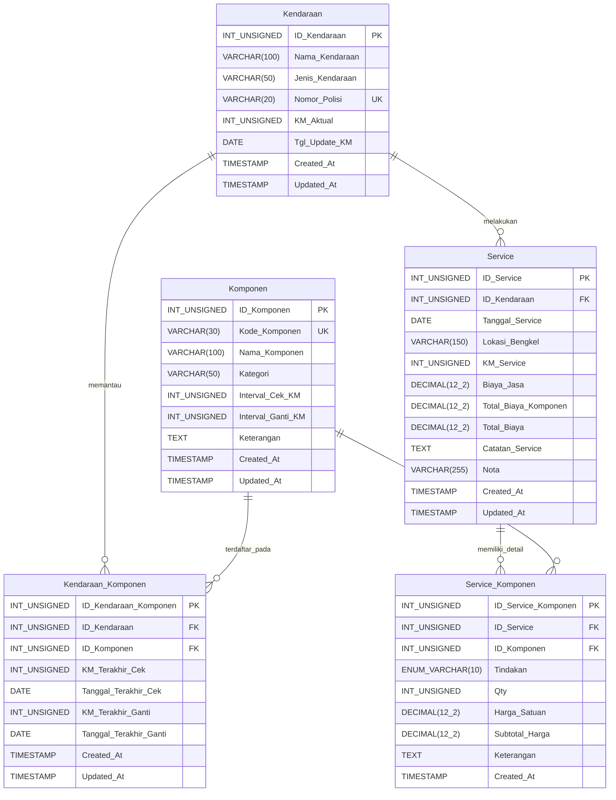

# Database Guide: Spesifikasi Tabel, Kolom, Tipe Data, dan Relasi

Dokumen ini menjelaskan secara rinci struktur **5 tabel utama** sistem pencatatan servis dan pengelolaan komponen kendaraan beserta nama kolom, tipe data, panjang data (untuk MySQL/MariaDB pada versi PHP), padanan kolom pada Google Sheets (Apps Script), *constraint*, indeks, serta *query* SQL DDL lengkapnya.

---

## Ringkasan Daftar Tabel

| No | Nama Tabel | Peran / Fungsi Utama | Relasi (Foreign Key) |
|---|---|---|---|
| 1 | `Kendaraan` | Menyimpan data induk akun kendaraan beserta posisi kilometer odometer aktual terakhir. | - |
| 2 | `Komponen` | Menyimpan katalog master komponen berdasarkan kategori kendaraan beserta interval KM cek & ganti. | - |
| 3 | `Kendaraan_Komponen` | Menyimpan daftar komponen yang dipantau pada suatu kendaraan beserta riwayat KM & tanggal terakhir cek dan ganti. | `ID_Kendaraan` $\rightarrow$ `Kendaraan`<br>`ID_Komponen` $\rightarrow$ `Komponen` |
| 4 | `Service` | Menyimpan transaksi *header* servis kendaraan, biaya jasa, total biaya, catatan, dan foto/link nota servis. | `ID_Kendaraan` $\rightarrow$ `Kendaraan` |
| 5 | `Service_Komponen` | Menyimpan detail item komponen yang **Diganti** atau **Dicek** pada suatu transaksi servis. | `ID_Service` $\rightarrow$ `Service`<br>`ID_Komponen` $\rightarrow$ `Komponen` |

---

## Diagram Relasi Tabel (ERD)



---

## 1. Tabel `Kendaraan` (`database/kendaraan.sql`)

Menyimpan profil setiap akun kendaraan yang terdaftar di dalam sistem.

### Spesifikasi Kolom

| No | Nama Kolom | Tipe Data & Panjang (SQL) | Nullable | Default | Atribut / Constraint | Penjelasan & Aturan Bisnis |
|---|---|---|---|---|---|---|
| 1 | `ID_Kendaraan` | `INT(10) UNSIGNED` | `NOT NULL` | `AUTO_INCREMENT` | `PRIMARY KEY` | ID unik akun kendaraan. |
| 2 | `Nama_Kendaraan` | `VARCHAR(100)` | `NOT NULL` | - | - | Nama/model kendaraan (contoh: `Honda Vario 150`, `Toyota Avanza`). |
| 3 | `Jenis_Kendaraan` | `VARCHAR(50)` | `NOT NULL` | - | - | Kategori kendaraan. Pilihan valid: `Motor Matic`, `Motor Bebek`, `Motor Sport`, `Mobil Matic`, `Mobil Manual`. |
| 4 | `Nomor_Polisi` | `VARCHAR(20)` | `NOT NULL` | - | `UNIQUE` | Plat nomor kendaraan (disimpan huruf kapital/`UPPERCASE`, tidak boleh kembar antar kendaraan). |
| 5 | `KM_Aktual` | `INT(10) UNSIGNED` | `NOT NULL` | `0` | - | Posisi kilometer odometer tertinggi/terkini kendaraan. |
| 6 | `Tgl_Update_KM` | `DATE` | `NULL` | `NULL` | - | Tanggal terakhir `KM_Aktual` diperbarui (baik dari menu Cek KM maupun dari transaksi Servis). |
| 7 | `Created_At` | `TIMESTAMP` | `NOT NULL` | `CURRENT_TIMESTAMP` | - | Waktu pembuatan data kendaraan. |
| 8 | `Updated_At` | `TIMESTAMP` | `NOT NULL` | `CURRENT_TIMESTAMP` | `ON UPDATE CURRENT_TIMESTAMP` | Waktu terakhir perubahan data kendaraan. |

### DDL SQL (`database/kendaraan.sql`)

```sql
CREATE TABLE IF NOT EXISTS `Kendaraan` (
    `ID_Kendaraan` INT UNSIGNED AUTO_INCREMENT PRIMARY KEY,
    `Nama_Kendaraan` VARCHAR(100) NOT NULL,
    `Jenis_Kendaraan` VARCHAR(50) NOT NULL,
    `Nomor_Polisi` VARCHAR(20) NOT NULL UNIQUE,
    `KM_Aktual` INT UNSIGNED NOT NULL DEFAULT 0,
    `Tgl_Update_KM` DATE NULL DEFAULT NULL,
    `Created_At` TIMESTAMP DEFAULT CURRENT_TIMESTAMP,
    `Updated_At` TIMESTAMP DEFAULT CURRENT_TIMESTAMP ON UPDATE CURRENT_TIMESTAMP
) ENGINE=InnoDB DEFAULT CHARSET=utf8mb4 COLLATE=utf8mb4_unicode_ci;
```

---

## 2. Tabel `Komponen` (`database/komponen.sql`)

Menyimpan katalog master komponen yang dikelompokkan berdasarkan `Kategori` kendaraan, lengkap dengan patokan **Interval Cek KM** (Warning Kuning) dan **Interval Ganti KM** (Warning Merah).

### Spesifikasi Kolom

| No | Nama Kolom | Tipe Data & Panjang (SQL) | Nullable | Default | Atribut / Constraint | Penjelasan & Aturan Bisnis |
|---|---|---|---|---|---|---|
| 1 | `ID_Komponen` | `INT(10) UNSIGNED` | `NOT NULL` | `AUTO_INCREMENT` | `PRIMARY KEY` | ID unik master komponen. |
| 2 | `Kode_Komponen` | `VARCHAR(30)` | `NOT NULL` | - | `UNIQUE` | Kode unik komponen (disimpan `UPPERCASE`, contoh: `MT-001`, `MB-001`). |
| 3 | `Nama_Komponen` | `VARCHAR(100)` | `NOT NULL` | - | - | Nama komponen (contoh: `Oli Mesin`, `Kampas Rem Depan`, `V-Belt CVT`). |
| 4 | `Kategori` | `VARCHAR(50)` | `NOT NULL` | - | `INDEX` | Kategori jenis kendaraan (`Motor Matic`, `Motor Bebek`, `Motor Sport`, `Mobil Matic`, `Mobil Manual`). Digunakan untuk menyaring pilihan komponen agar sesuai dengan `Jenis_Kendaraan` aktif. |
| 5 | `Interval_Cek_KM` | `INT(10) UNSIGNED` | `NULL` | `NULL` | - | Rekomendasi interval pemeriksaan dalam KM (pemicu status **Perlu Dicek / Warning Kuning**). Boleh `NULL` jika komponen tidak memiliki jadwal cek berkala. |
| 6 | `Interval_Ganti_KM` | `INT(10) UNSIGNED` | `NULL` | `NULL` | - | Rekomendasi interval penggantian dalam KM (pemicu status **Harus Diganti / Warning Merah**). Boleh `NULL` jika komponen hanya mengandalkan pemeriksaan (`Interval_Cek_KM`). |
| 7 | `Keterangan` | `TEXT` | `NULL` | `NULL` | - | Catatan atau spesifikasi komponen (ditampilkan di katalog master dan di halaman detail riwayat komponen kendaraan). |
| 8 | `Created_At` | `TIMESTAMP` | `NOT NULL` | `CURRENT_TIMESTAMP` | - | Waktu pembuatan master komponen. |
| 9 | `Updated_At` | `TIMESTAMP` | `NOT NULL` | `CURRENT_TIMESTAMP` | `ON UPDATE CURRENT_TIMESTAMP` | Waktu terakhir pembaruan master komponen. |

> **Aturan Validasi Interval Komponen:**
> - Minimal salah satu dari `Interval_Cek_KM` atau `Interval_Ganti_KM` **wajib diisi** (`> 0`).
> - Jika keduanya diisi sekaligus, maka nilai `Interval_Cek_KM` **harus lebih kecil** dari `Interval_Ganti_KM` (`Interval_Cek_KM < Interval_Ganti_KM`).

### DDL SQL (`database/komponen.sql`)

```sql
CREATE TABLE IF NOT EXISTS `Komponen` (
    `ID_Komponen` INT UNSIGNED AUTO_INCREMENT PRIMARY KEY,
    `Kode_Komponen` VARCHAR(30) NOT NULL UNIQUE,
    `Nama_Komponen` VARCHAR(100) NOT NULL,
    `Kategori` VARCHAR(50) NOT NULL,
    `Interval_Cek_KM` INT UNSIGNED NULL DEFAULT NULL,
    `Interval_Ganti_KM` INT UNSIGNED NULL DEFAULT NULL,
    `Keterangan` TEXT NULL DEFAULT NULL,
    `Created_At` TIMESTAMP DEFAULT CURRENT_TIMESTAMP,
    `Updated_At` TIMESTAMP DEFAULT CURRENT_TIMESTAMP ON UPDATE CURRENT_TIMESTAMP,
    INDEX `idx_komponen_kategori` (`Kategori`)
) ENGINE=InnoDB DEFAULT CHARSET=utf8mb4 COLLATE=utf8mb4_unicode_ci;
```

---

## 3. Tabel `Kendaraan_Komponen` (`database/kendaraan_komponen.sql`)

Tabel penghubung (*pivot/state table*) antara `Kendaraan` dan `Komponen` yang menyimpan posisi kilometer dan tanggal terakhir komponen tersebut **Dicek** maupun **Diganti** pada kendaraan terkait.

### Spesifikasi Kolom

| No | Nama Kolom | Tipe Data & Panjang (SQL) | Nullable | Default | Atribut / Constraint | Penjelasan & Aturan Bisnis |
|---|---|---|---|---|---|---|
| 1 | `ID_Kendaraan_Komponen` | `INT(10) UNSIGNED` | `NOT NULL` | `AUTO_INCREMENT` | `PRIMARY KEY` | ID unik baris relasi komponen kendaraan. |
| 2 | `ID_Kendaraan` | `INT(10) UNSIGNED` | `NOT NULL` | - | `FOREIGN KEY` | Mengacu ke `Kendaraan.ID_Kendaraan` (`ON DELETE CASCADE`). |
| 3 | `ID_Komponen` | `INT(10) UNSIGNED` | `NOT NULL` | - | `FOREIGN KEY` | Mengacu ke `Komponen.ID_Komponen` (`ON DELETE RESTRICT`). |
| 4 | `KM_Terakhir_Cek` | `INT(10) UNSIGNED` | `NULL` | `NULL` | - | Odometer KM terakhir komponen ini **Dicek** atau **Diganti** pada servis. Menjadi titik awal perhitungan `Target_KM_Cek`. |
| 5 | `Tanggal_Terakhir_Cek` | `DATE` | `NULL` | `NULL` | - | Tanggal servis terakhir saat komponen ini **Dicek** atau **Diganti**. |
| 6 | `KM_Terakhir_Ganti` | `INT(10) UNSIGNED` | `NULL` | `NULL` | - | Odometer KM terakhir komponen ini **Diganti** baru pada servis. Menjadi titik awal perhitungan `Target_KM_Ganti`. |
| 7 | `Tanggal_Terakhir_Ganti` | `DATE` | `NULL` | `NULL` | - | Tanggal servis terakhir saat komponen ini **Diganti** baru. |
| 8 | `Created_At` | `TIMESTAMP` | `NOT NULL` | `CURRENT_TIMESTAMP` | - | Waktu komponen mulai didaftarkan ke kendaraan. |
| 9 | `Updated_At` | `TIMESTAMP` | `NOT NULL` | `CURRENT_TIMESTAMP` | `ON UPDATE CURRENT_TIMESTAMP` | Waktu terakhir sinkronisasi status komponen. |

### DDL SQL (`database/kendaraan_komponen.sql`)

```sql
CREATE TABLE IF NOT EXISTS `Kendaraan_Komponen` (
    `ID_Kendaraan_Komponen` INT UNSIGNED AUTO_INCREMENT PRIMARY KEY,
    `ID_Kendaraan` INT UNSIGNED NOT NULL,
    `ID_Komponen` INT UNSIGNED NOT NULL,
    `KM_Terakhir_Cek` INT UNSIGNED NULL DEFAULT NULL,
    `Tanggal_Terakhir_Cek` DATE NULL DEFAULT NULL,
    `KM_Terakhir_Ganti` INT UNSIGNED NULL DEFAULT NULL,
    `Tanggal_Terakhir_Ganti` DATE NULL DEFAULT NULL,
    `Created_At` TIMESTAMP DEFAULT CURRENT_TIMESTAMP,
    `Updated_At` TIMESTAMP DEFAULT CURRENT_TIMESTAMP ON UPDATE CURRENT_TIMESTAMP,
    UNIQUE KEY `uk_kendaraan_komponen` (`ID_Kendaraan`, `ID_Komponen`),
    CONSTRAINT `fk_kk_kendaraan` FOREIGN KEY (`ID_Kendaraan`) REFERENCES `Kendaraan` (`ID_Kendaraan`) ON DELETE CASCADE ON UPDATE CASCADE,
    CONSTRAINT `fk_kk_komponen` FOREIGN KEY (`ID_Komponen`) REFERENCES `Komponen` (`ID_Komponen`) ON DELETE RESTRICT ON UPDATE CASCADE
) ENGINE=InnoDB DEFAULT CHARSET=utf8mb4 COLLATE=utf8mb4_unicode_ci;
```

---

## 4. Tabel `Service` (`database/service.sql`)

Menyimpan data *header* setiap kunjungan/transaksi servis kendaraan.

### Spesifikasi Kolom

| No | Nama Kolom | Tipe Data & Panjang (SQL) | Nullable | Default | Atribut / Constraint | Penjelasan & Aturan Bisnis |
|---|---|---|---|---|---|---|
| 1 | `ID_Service` | `INT(10) UNSIGNED` | `NOT NULL` | `AUTO_INCREMENT` | `PRIMARY KEY` | ID unik transaksi servis. |
| 2 | `ID_Kendaraan` | `INT(10) UNSIGNED` | `NOT NULL` | - | `FOREIGN KEY` | Mengacu ke `Kendaraan.ID_Kendaraan` (`ON DELETE RESTRICT`). |
| 3 | `Tanggal_Service` | `DATE` | `NOT NULL` | - | `INDEX` | Tanggal pelaksanaan servis (`YYYY-MM-DD`). |
| 4 | `Lokasi_Bengkel` | `VARCHAR(150)` | `NULL` | `NULL` | - | Nama atau lokasi bengkel tempat servis dilakukan. |
| 5 | `KM_Service` | `INT(10) UNSIGNED` | `NOT NULL` | `0` | - | Angka odometer kendaraan pada saat servis dilakukan (boleh lebih rendah dari `KM_Aktual` untuk pencatatan riwayat servis lama/mundur). |
| 6 | `Biaya_Jasa` | `DECIMAL(12, 2)` | `NOT NULL` | `0.00` | - | Biaya ongkos jasa mekanik/bengkel. |
| 7 | `Total_Biaya_Komponen` | `DECIMAL(12, 2)` | `NOT NULL` | `0.00` | - | Akumulasi `SUM(Subtotal_Harga)` dari seluruh item pada `Service_Komponen` untuk `ID_Service` ini. |
| 8 | `Total_Biaya` | `DECIMAL(12, 2)` | `NOT NULL` | `0.00` | - | Total biaya servis (`Biaya_Jasa + Total_Biaya_Komponen`). |
| 9 | `Catatan_Service` | `TEXT` | `NULL` | `NULL` | - | Catatan keluhan atau pengerjaan servis (opsional). |
| 10 | `Nota` | `VARCHAR(255)` | `NULL` | `NULL` | - | URL/link Google Drive atau path file lokal (`uploads/nota/...`) untuk foto struk/nota servis (opsional). |
| 11 | `Created_At` | `TIMESTAMP` | `NOT NULL` | `CURRENT_TIMESTAMP` | - | Waktu pencatatan transaksi servis. |
| 12 | `Updated_At` | `TIMESTAMP` | `NOT NULL` | `CURRENT_TIMESTAMP` | `ON UPDATE CURRENT_TIMESTAMP` | Waktu terakhir perubahan transaksi servis. |

### DDL SQL (`database/service.sql`)

```sql
CREATE TABLE IF NOT EXISTS `Service` (
    `ID_Service` INT UNSIGNED AUTO_INCREMENT PRIMARY KEY,
    `ID_Kendaraan` INT UNSIGNED NOT NULL,
    `Tanggal_Service` DATE NOT NULL,
    `Lokasi_Bengkel` VARCHAR(150) NULL DEFAULT NULL,
    `KM_Service` INT UNSIGNED NOT NULL DEFAULT 0,
    `Biaya_Jasa` DECIMAL(12, 2) NOT NULL DEFAULT 0.00,
    `Total_Biaya_Komponen` DECIMAL(12, 2) NOT NULL DEFAULT 0.00,
    `Total_Biaya` DECIMAL(12, 2) NOT NULL DEFAULT 0.00,
    `Catatan_Service` TEXT NULL DEFAULT NULL,
    `Nota` VARCHAR(255) NULL DEFAULT NULL,
    `Created_At` TIMESTAMP DEFAULT CURRENT_TIMESTAMP,
    `Updated_At` TIMESTAMP DEFAULT CURRENT_TIMESTAMP ON UPDATE CURRENT_TIMESTAMP,
    INDEX `idx_service_kendaraan_tanggal` (`ID_Kendaraan`, `Tanggal_Service`),
    CONSTRAINT `fk_service_kendaraan` FOREIGN KEY (`ID_Kendaraan`) REFERENCES `Kendaraan` (`ID_Kendaraan`) ON DELETE RESTRICT ON UPDATE CASCADE
) ENGINE=InnoDB DEFAULT CHARSET=utf8mb4 COLLATE=utf8mb4_unicode_ci;
```

---

## 5. Tabel `Service_Komponen` (`database/service_komponen.sql`)

Menyimpan rincian komponen yang **Diganti (`Ganti`)** maupun **Diperiksa/Diservis (`Cek`)** pada suatu transaksi servis.

### Spesifikasi Kolom

| No | Nama Kolom | Tipe Data & Panjang (SQL) | Nullable | Default | Atribut / Constraint | Penjelasan & Aturan Bisnis |
|---|---|---|---|---|---|---|
| 1 | `ID_Service_Komponen` | `INT(10) UNSIGNED` | `NOT NULL` | `AUTO_INCREMENT` | `PRIMARY KEY` | ID unik item detail servis komponen. |
| 2 | `ID_Service` | `INT(10) UNSIGNED` | `NOT NULL` | - | `FOREIGN KEY` | Mengacu ke `Service.ID_Service` (`ON DELETE CASCADE`). |
| 3 | `ID_Komponen` | `INT(10) UNSIGNED` | `NOT NULL` | - | `FOREIGN KEY` | Mengacu ke `Komponen.ID_Komponen` (`ON DELETE RESTRICT`). |
| 4 | `Tindakan` | `ENUM('Ganti', 'Cek')` atau `VARCHAR(10)` | `NOT NULL` | `'Ganti'` | - | Kategori tindakan servis pada komponen:<br>- `'Ganti'`: Komponen diganti baru (me-reset `KM_Terakhir_Ganti` sekaligus `KM_Terakhir_Cek`).<br>- `'Cek'`: Komponen hanya diperiksa/dibersihkan/disetel (hanya me-reset `KM_Terakhir_Cek`). |
| 5 | `Qty` | `INT(10) UNSIGNED` | `NOT NULL` | `1` | - | Jumlah/kuantitas komponen (minimal `1`). |
| 6 | `Harga_Satuan` | `DECIMAL(12, 2)` | `NOT NULL` | `0.00` | - | Harga satuan komponen (boleh `0` terutama untuk tindakan `'Cek'`). |
| 7 | `Subtotal_Harga` | `DECIMAL(12, 2)` | `NOT NULL` | `0.00` | - | Hasil perkalian `Qty * Harga_Satuan`. |
| 8 | `Keterangan` | `TEXT` | `NULL` | `NULL` | - | Catatan merek sparepart atau kondisi hasil pengecekan (opsional). |
| 9 | `Created_At` | `TIMESTAMP` | `NOT NULL` | `CURRENT_TIMESTAMP` | - | Waktu pencatatan item komponen servis. |

### DDL SQL (`database/service_komponen.sql`)

```sql
CREATE TABLE IF NOT EXISTS `Service_Komponen` (
    `ID_Service_Komponen` INT UNSIGNED AUTO_INCREMENT PRIMARY KEY,
    `ID_Service` INT UNSIGNED NOT NULL,
    `ID_Komponen` INT UNSIGNED NOT NULL,
    `Tindakan` ENUM('Ganti', 'Cek') NOT NULL DEFAULT 'Ganti',
    `Qty` INT UNSIGNED NOT NULL DEFAULT 1,
    `Harga_Satuan` DECIMAL(12, 2) NOT NULL DEFAULT 0.00,
    `Subtotal_Harga` DECIMAL(12, 2) NOT NULL DEFAULT 0.00,
    `Keterangan` TEXT NULL DEFAULT NULL,
    `Created_At` TIMESTAMP DEFAULT CURRENT_TIMESTAMP,
    INDEX `idx_sk_service` (`ID_Service`),
    INDEX `idx_sk_komponen` (`ID_Komponen`),
    CONSTRAINT `fk_sk_service` FOREIGN KEY (`ID_Service`) REFERENCES `Service` (`ID_Service`) ON DELETE CASCADE ON UPDATE CASCADE,
    CONSTRAINT `fk_sk_komponen` FOREIGN KEY (`ID_Komponen`) REFERENCES `Komponen` (`ID_Komponen`) ON DELETE RESTRICT ON UPDATE CASCADE
) ENGINE=InnoDB DEFAULT CHARSET=utf8mb4 COLLATE=utf8mb4_unicode_ci;
```
