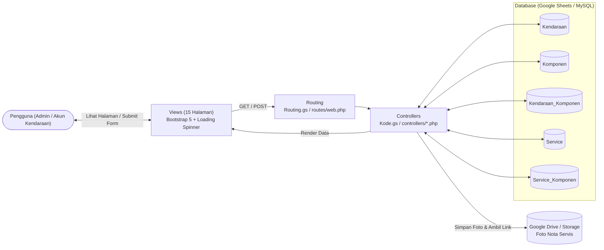
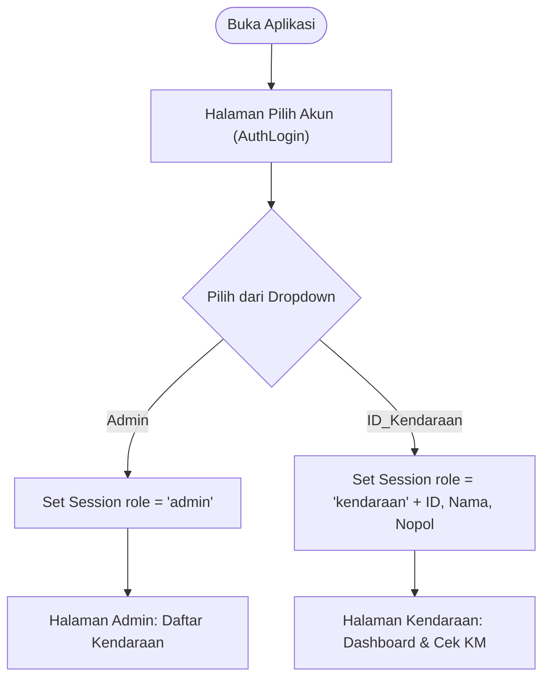
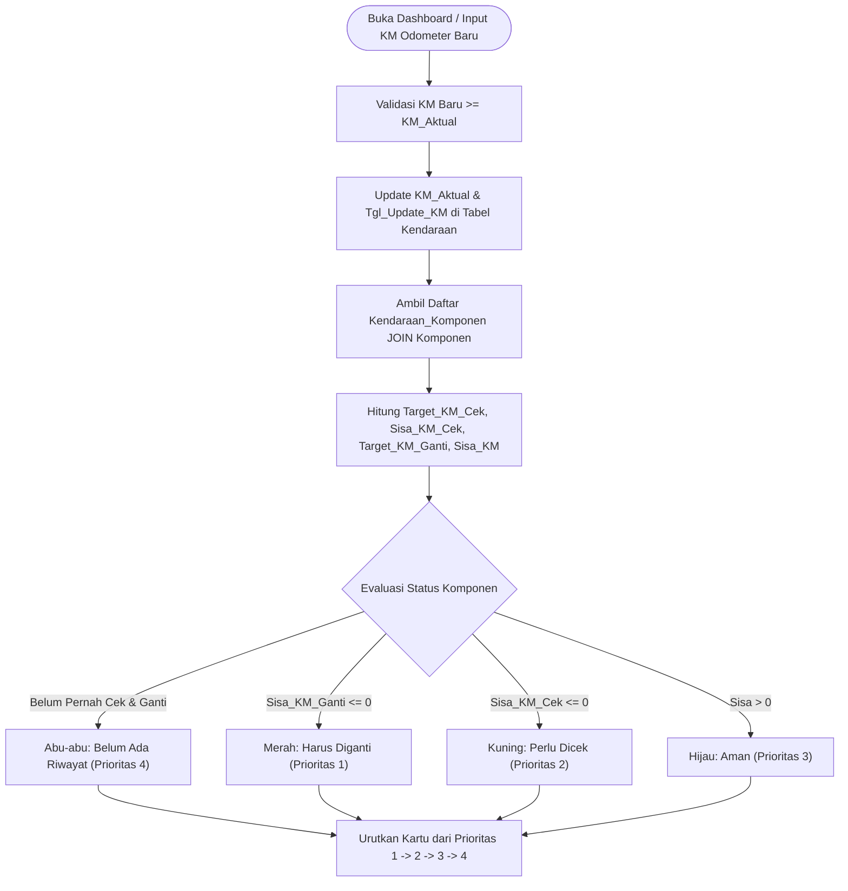
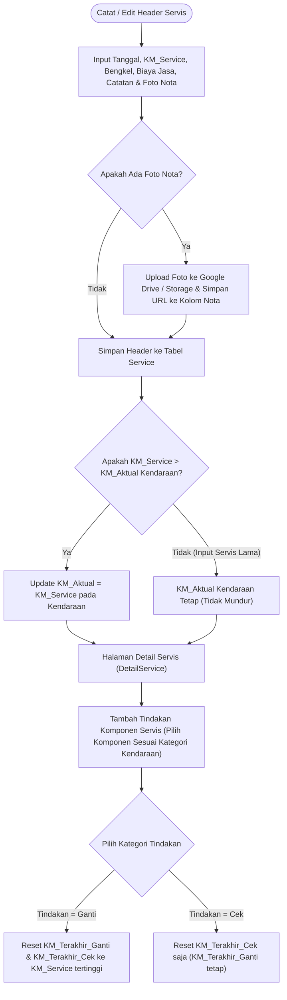

# System Flow & Business Rules: Sistem Pencatatan Servis dan Pengelolaan Komponen Kendaraan

Dokumen ini menjelaskan alur kerja sistem secara menyeluruh beserta **aturan bisnis (*business rules*)** pada setiap tahapan alur. Dokumen ini berlaku sebagai acuan utama (*single source of truth*) baik untuk implementasi **Google Apps Script + Google Sheets** maupun **PHP Native + MySQL**.

> **Referensi Dokumen Pendamping:**
> - [databaseguide.md](file:///d:/Belajar/Appscript/tryone/docs/databaseguide.md): Spesifikasi lengkap 5 tabel, kolom, tipe data, panjang data, dan DDL SQL.
> - [controllerguide.md](file:///d:/Belajar/Appscript/tryone/docs/controllerguide.md): Rincian file Controller beserta daftar fungsi dan logika bisnis di dalamnya.
> - [viewsguide.md](file:///d:/Belajar/Appscript/tryone/docs/viewsguide.md): Rincian 15 halaman View, isi komponen UI, dan tujuan masing-masing halaman.

---

## 1. Gambaran Umum & Dua Sisi Pengguna

Sistem dirancang dengan antarmuka **Phone-View Oriented** menggunakan Bootstrap 5 dan memiliki **2 peran/sisi pengguna** yang dipilih pada halaman awal tanpa password:

1. **Sisi Admin (`role = admin`)**:
   - Mengelola data induk **Kendaraan** (melihat daftar semua kendaraan dan mendaftarkan kendaraan baru dengan 5 pilihan kategori jenis kendaraan).
   - Mengelola katalog **Master Komponen** (menentukan kategori kendaraan untuk komponen tersebut, patokan **Interval Cek KM**, **Interval Ganti KM**, dan keterangan komponen).
2. **Sisi Akun Kendaraan (`role = kendaraan`, mengikat 1 `ID_Kendaraan`)**:
   - Seluruh halaman di dalamnya hanya menampilkan dan memproses data milik **1 kendaraan yang sedang aktif**.
   - Memiliki 3 menu utama:
     1. **Beranda & Cek KM (`Dashboard`)**: Memasukkan odometer terbaru dan melihat rekomendasi komponen dengan urutan prioritas **Warning Merah (`Harus Diganti`)** $\rightarrow$ **Warning Kuning (`Perlu Dicek`)** $\rightarrow$ **Hijau (`Aman`)** $\rightarrow$ **Abu-abu (`Belum Ada Riwayat`)**.
     2. **Komponen Kendaraan (`Kendaraan_Komponen`)**: Melihat daftar komponen yang dipantau beserta jumlah riwayat servisnya (`X Riwayat (Yx Ganti, Zx Cek)`), menambahkan komponen baru ke kendaraan, dan melihat tabel riwayat beserta rata-rata interval/selisih KM aktual setiap komponen.
     3. **Riwayat Servis (`Service` & `Service_Komponen`)**: Mencatat servis baru (mendukung input servis mundur sebelum odometer saat ini & upload foto nota ke Google Drive/penyimpanan), mengubah data servis, serta mencatat tindakan **`Ganti`** atau **`Cek`** pada komponen saat servis.

### Diagram Arsitektur Sistem

---

## 2. Alur 1: Pemilihan Akun Masuk (Auth Login Tanpa Password)

### Aturan Bisnis (Business Rules) Tahap Login:
1. **Dropdown Dinamis**: Daftar pilihan akun kendaraan diambil langsung dari tabel `Kendaraan` diurutkan berdasarkan `Nama_Kendaraan ASC`. Jika belum ada kendaraan terdaftar, opsi kendaraan dinonaktifkan dan pengguna diarahkan masuk sebagai Admin terlebih dahulu.
2. **Isolasi Session**:
   - Saat masuk sebagai `admin`, session kendaraan (`kendaraan_id`, `kendaraan_nama`, `kendaraan_nopol`) dibersihkan.
   - Saat masuk sebagai `kendaraan`, seluruh request ke menu kendaraan selalu mengambil `ID_Kendaraan` dari session aktif (pengguna tidak bisa melihat atau mengubah data kendaraan lain).

---

## 3. Alur 2: Pengelolaan Master Data oleh Admin (Kendaraan & Komponen)

### A. Pendaftaran Kendaraan Baru
1. Admin mengisi `Nama_Kendaraan`, `Jenis_Kendaraan`, `Nomor_Polisi`, dan `KM_Aktual` awal.
2. **Business Rules**:
   - **5 Kategori Jenis Kendaraan**: `Motor Matic`, `Motor Bebek`, `Motor Sport`, `Mobil Matic`, dan `Mobil Manual`.
   - `Nomor_Polisi` otomatis diubah menjadi huruf kapital (`UPPERCASE`) dan divalidasi **wajib unik** (tidak boleh sama dengan kendaraan lain).
   - `Tgl_Update_KM` otomatis diisi dengan tanggal hari ini saat kendaraan dibuat.

### B. Pengelolaan Master Komponen (`Interval_Cek_KM` & `Interval_Ganti_KM`)
1. Admin mengisi `Kode_Komponen`, `Nama_Komponen`, `Kategori`, `Interval_Cek_KM`, `Interval_Ganti_KM`, dan `Keterangan`.
2. **Business Rules**:
   - **Kategori Kendaraan pada Komponen**: Setiap master komponen wajib memiliki 1 `Kategori` dari 5 jenis kendaraan (`Motor Matic`, `Motor Bebek`, `Motor Sport`, `Mobil Matic`, `Mobil Manual`).
   - **Fleksibilitas Dua Interval (Cek & Ganti)**:
     - Komponen boleh **hanya memiliki `Interval_Cek_KM`** (sedangkan `Interval_Ganti_KM` dikosongkan/`NULL`) — contoh: komponen yang hanya diperiksa/disetel berkala tanpa jadwal ganti tetap.
     - Komponen boleh **hanya memiliki `Interval_Ganti_KM`** (sedangkan `Interval_Cek_KM` dikosongkan/`NULL`) — contoh: komponen yang langsung diganti berkala tanpa jadwal cek terpisah.
     - Komponen boleh **memiliki keduanya sekaligus** (`Interval_Cek_KM` dan `Interval_Ganti_KM`).
     - **Validasi Wajib**: Minimal salah satu dari `Interval_Cek_KM` atau `Interval_Ganti_KM` harus diisi (`> 0`). Jika keduanya diisi sekaligus, maka wajib memenuhi syarat:
       $$\text{Interval\_Cek\_KM} < \text{Interval\_Ganti\_KM}$$

---

## 4. Alur 3: Pemeriksaan Odometer (Cek KM) & Evaluasi Status Komponen di Dashboard

### Aturan Bisnis (Business Rules) Evaluasi & Urutan Dashboard:
1. **Validasi Update Odometer di Beranda**:
   - Saat pengguna menginput odometer baru lewat form **Cek KM**, angka `km_odometer` **tidak boleh lebih kecil** dari `KM_Aktual` yang sudah tercatat pada kendaraan (`km_odometer >= KM_Aktual`).
2. **Rumus Perhitungan Target & Sisa KM**:
   - Patokan awal ganti: $\text{KM\_Terakhir\_Ganti}$.
   - Patokan awal cek: $\text{KM\_Terakhir\_Cek}$ (jika $\text{KM\_Terakhir\_Cek}$ kosong tetapi sudah ada $\text{KM\_Terakhir\_Ganti}$, maka gunakan $\text{KM\_Terakhir\_Ganti}$).
   - Jika komponen memiliki `Interval_Cek_KM > 0` dan sudah memiliki riwayat cek/ganti:
     $$\text{Target\_KM\_Cek} = \text{KM\_Terakhir\_Cek} + \text{Interval\_Cek\_KM}$$
     $$\text{Sisa\_KM\_Cek} = \text{Target\_KM\_Cek} - \text{KM\_Aktual}$$
   - Jika komponen memiliki `Interval_Ganti_KM > 0` dan sudah memiliki riwayat ganti:
     $$\text{Target\_KM\_Ganti} = \text{KM\_Terakhir\_Ganti} + \text{Interval\_Ganti\_KM}$$
     $$\text{Sisa\_KM} = \text{Target\_KM\_Ganti} - \text{KM\_Aktual}$$
3. **Prioritas Penentuan Status & Warna Warning**:
   - **Prioritas 1 — Warning Merah (`Harus Diganti`)**: Jika komponen memiliki `Target_KM_Ganti` dan $\text{Sisa\_KM} \le 0$. (Meskipun jadwal cek juga terlewati, status `Harus Diganti` selalu menang di atas `Perlu Dicek`).
   - **Prioritas 2 — Warning Kuning (`Perlu Dicek`)**: Jika belum mencapai `Harus Diganti` (atau tidak punya `Interval_Ganti_KM`), tetapi memiliki `Target_KM_Cek` dan $\text{Sisa\_KM\_Cek} \le 0$.
   - **Prioritas 3 — Hijau (`Aman`)**: Jika memiliki riwayat dan baik `Sisa_KM` maupun `Sisa_KM_Cek` masih `> 0`.
   - **Prioritas 4 — Abu-abu (`Belum Ada Riwayat`)**: Jika komponen baru didaftarkan ke kendaraan dan belum pernah tercatat pada transaksi servis sama sekali.
4. **Pengurutan Tampilan Kartu di Dashboard**:
   - Daftar komponen pada Dashboard **wajib diurutkan berdasarkan prioritas status** (`Harus Diganti` $\rightarrow$ `Perlu Dicek` $\rightarrow$ `Aman` $\rightarrow$ `Belum Ada Riwayat`), baru kemudian diurutkan berdasarkan `Kode_Komponen ASC`. Dengan demikian, begitu halaman dibuka, pemilik kendaraan langsung melihat komponen yang harus segera diganti dan dicek di urutan paling atas.

---

## 5. Alur 4: Pencatatan Servis, Upload Foto Nota, & Tindakan Komponen (`Cek` vs `Ganti`)

### Aturan Bisnis (Business Rules) Transaksi Servis:
1. **Mendukung Pencatatan Servis Mundur (Sebelum Odometer Saat Ini)**:
   - Berbeda dengan form *Cek KM* di beranda, pada form **Catat Servis Baru (`BuatService`)** dan **Ubah Servis (`UbahService`)**, pengguna **diizinkan memasukkan `KM_Service` yang lebih kecil dari `KM_Aktual` kendaraan** (agar pengguna bisa menyusul pencatatan riwayat servis lama).
   - **Aturan Sinkronisasi Odometer Kendaraan**: `KM_Aktual` (dan `Tgl_Update_KM`) pada tabel `Kendaraan` **hanya akan diperbarui jika `KM_Service > KM_Aktual` kendaraan saat ini**. Jika pengguna menginput servis lama dengan `KM_Service <= KM_Aktual`, maka odometer terkini kendaraan tidak akan mundur.
2. **Penomoran Urutan Servis Kronologis (`Servis ke-1` s/d `Servis ke-N`)**:
   - Pada halaman **Riwayat Servis (`DaftarService`)**, seluruh transaksi servis milik kendaraan aktif diurutkan terlebih dahulu dari yang paling awal ke paling baru (`Tanggal_Service ASC, KM_Service ASC, ID_Service ASC`) untuk menentukan nomor **`Servis ke-1` (Servis Pertama)** hingga **`Servis ke-N` (Servis Terakhir)**.
   - Setelah mendapatkan nomor urut yang akurat, daftar ditampilkan terbalik (`DESC`) agar servis terbaru berada di paling atas.
3. **Upload Foto Nota ke Google Drive**:
   - Pengguna dapat melampirkan foto struk/nota servis pada saat membuat atau mengedit servis.
   - Foto otomatis dikompresi di sisi browser (maksimal `1280px` JPEG via `<canvas>`) agar proses unggah dari kamera HP cepat dan ringan, disimpan ke folder Google Drive (`Nota_ServisKendaraan` atau sesuai `DRIVE_FOLDER_ID`), dan link-nya disimpan ke kolom `Nota` pada tabel `Service`.
4. **Penyaringan Pilihan Komponen Berdasarkan Kategori Kendaraan**:
   - Saat menambahkan komponen pada halaman `DetailService` (maupun saat mendaftarkan komponen baru di `BuatKomponenKendaraan`), dropdown pilihan komponen **otomatis hanya menampilkan komponen yang memiliki `Kategori == Jenis_Kendaraan` dari kendaraan aktif**.
5. **Perbedaan Efek Tindakan `Ganti` vs `Cek` pada `Service_Komponen`**:
   - Setiap komponen yang ditambahkan ke detail servis memiliki atribut `Tindakan` (`'Ganti'` atau `'Cek'`):
     - **Jika `Tindakan = 'Cek'`**:
       - Hanya memperbarui `KM_Terakhir_Cek` dan `Tanggal_Terakhir_Cek` pada tabel `Kendaraan_Komponen` (diambil dari `KM_Service` tertinggi di antara seluruh riwayat `Cek` maupun `Ganti` komponen tersebut).
       - Nilai `KM_Terakhir_Ganti` **tidak berubah**, sehingga jadwal ganti komponen tetap berjalan menuju target ganti semula.
     - **Jika `Tindakan = 'Ganti'`**:
       - Memperbarui **`KM_Terakhir_Ganti` sekaligus `KM_Terakhir_Cek`** pada tabel `Kendaraan_Komponen` (diambil dari `KM_Service` tertinggi). Karena komponen sudah diganti baru, maka jadwal cek berkala berikutnya otomatis ikut dihitung ulang dari KM penggantian baru tersebut.
6. **Rekalkulasi Otomatis Saat Edit Servis atau Hapus Item Komponen**:
   - Setiap kali item pada `Service_Komponen` ditambah, dihapus, atau header `Service` diubah (`KM_Service`, `Tanggal_Service`, `Biaya_Jasa`):
     - `Total_Biaya_Komponen` dan `Total_Biaya` (`Biaya_Jasa + Total_Biaya_Komponen`) pada tabel `Service` dihitung ulang secara otomatis.
     - `KM_Terakhir_Cek`, `Tanggal_Terakhir_Cek`, `KM_Terakhir_Ganti`, dan `Tanggal_Terakhir_Ganti` pada `Kendaraan_Komponen` dihitung ulang dari seluruh riwayat `Service_Komponen JOIN Service` yang tersisa untuk menjaga konsistensi data 100%.

---

## 6. Alur 5: Statistik Riwayat, Perhitungan Selisih KM, & Rata-rata Interval Komponen

Pada menu **Komponen Kendaraan (`DaftarKomponenKendaraan` & `DetailKomponenKendaraan`)**:

1. **Statistik Jumlah Riwayat pada Kartu Komponen (`DaftarKomponenKendaraan`)**:
   - Setiap kartu komponen yang dipantau menampilkan badge ringkasan berapa kali komponen tersebut sudah pernah masuk dalam transaksi servis beserta rinciannya:
     $$\text{Contoh: } \mathbf{3\text{ Riwayat } (2\times\text{ Ganti}, 1\times\text{ Cek})}$$
2. **Perhitungan Selisih / Interval KM Aktual antar Servis (`DetailKomponenKendaraan`)**:
   - Seluruh riwayat servis untuk komponen tersebut diurutkan dari KM terendah ke tertinggi terlebih dahulu:
     - Untuk baris dengan **`Tindakan = 'Ganti'`**:
       $$\text{Selisih\_KM} = \text{KM\_Service}_{\text{saat ini}} - \text{KM\_Service}_{\text{Ganti sebelumnya}}$$
       *(Jika merupakan penggantian pertama kali, ditandai sebagai `Ganti Pertama` dan `Selisih_KM = null`)*.
     - Untuk baris dengan **`Tindakan = 'Cek'`**:
       $$\text{Selisih\_KM} = \text{KM\_Service}_{\text{saat ini}} - \text{KM\_Service}_{\text{Cek/Ganti sebelumnya}}$$
       *(Jika merupakan pengecekan pertama kali dan belum pernah ganti sebelumnya, ditandai sebagai `Cek Pertama` dan `Selisih\_KM = null`)*.
3. **Perhitungan Rata-rata Interval / Selisih KM**:
   - Di bagian informasi komponen (di atas tabel riwayat pada `DetailKomponenKendaraan`), sistem menampilkan:
     - **Keterangan Komponen** dari tabel Master `Komponen`.
     - **Interval Rekomendasi** (`Cek` / `Ganti`).
     - **Rata-rata Interval / Selisih KM Aktual**, yang dihitung dari rata-rata seluruh nilai `Selisih_KM` yang ada pada tabel riwayat komponen tersebut:
       $$\text{Rata-rata Selisih KM} = \text{round}\left(\frac{\sum \text{Selisih\_KM}}{\text{Jumlah Baris yang Memiliki Selisih\_KM}}\right)$$
